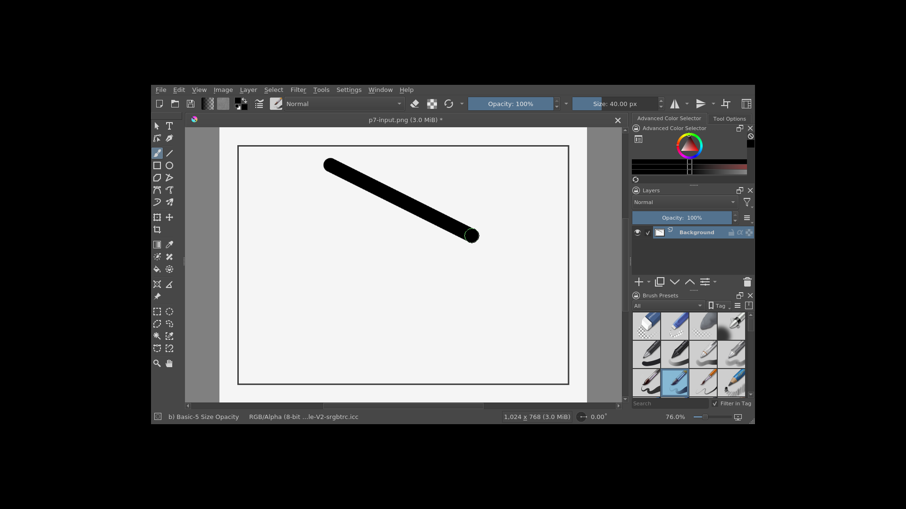
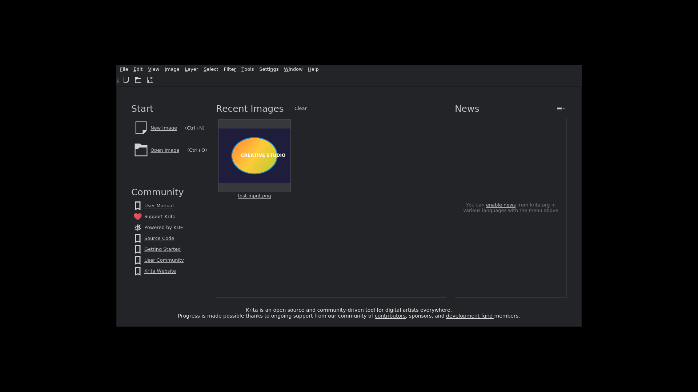
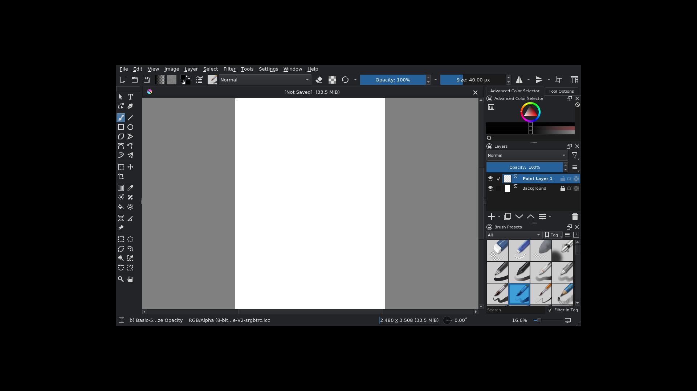
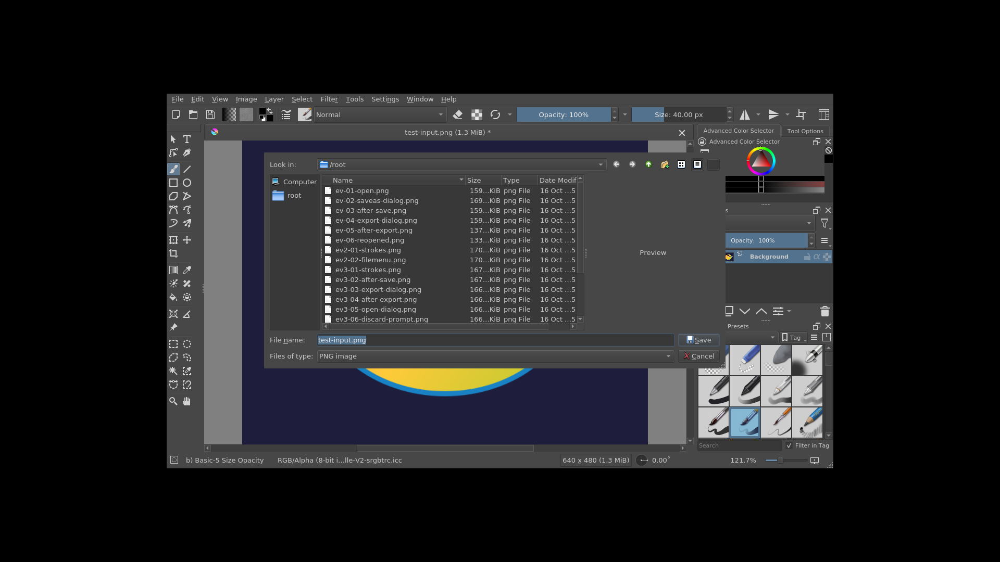
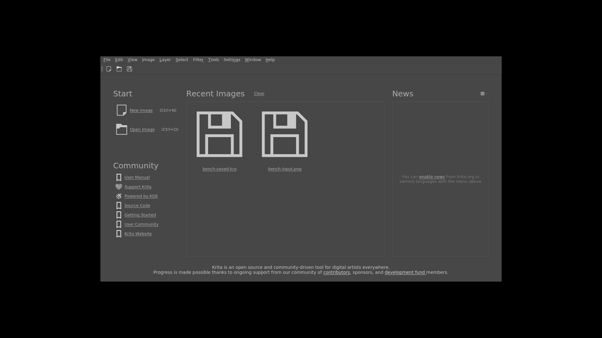
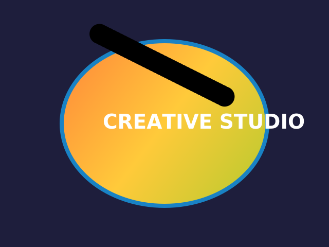
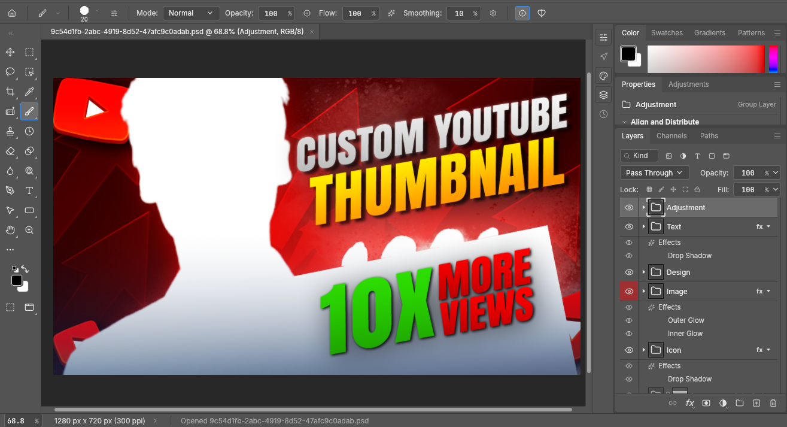
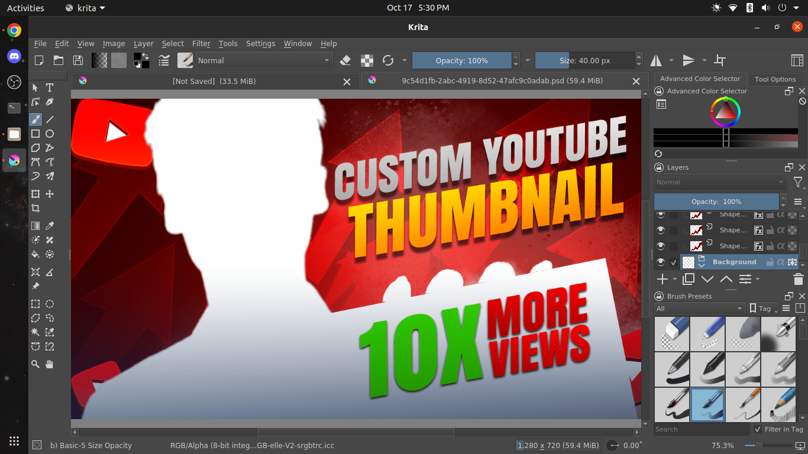
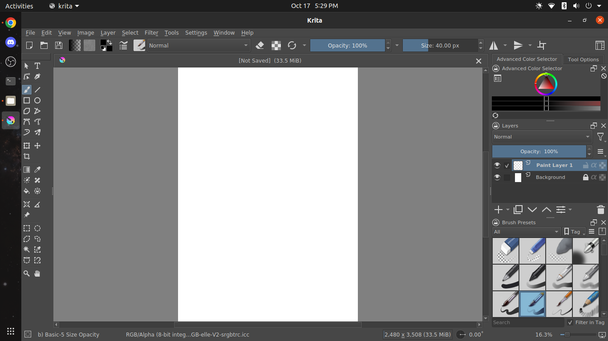

# Creative Studio Ultimate (Full)

**A professional image editing studio built from the KDE Krita 5.2.16 source tree, packaged as a fully self-contained AppImage for Ubuntu 20.04 LTS (x86_64) and compatible distributions.**

Base engine: Krita `v5.2.16` (commit `7d9aefc93f15998eca13458bb9a065e2cca77c02`) · Qt 5.12.8 · KF5 5.68 · built with gcc 9.4 inside a real Ubuntu 20.04 (focal) build environment, Release/-O2, generic x86-64/SSE2 baseline (no `-march=native`).


*The studio workspace: dark "Creative Studio Dark" theme, left toolbox, center canvas (real brush stroke), right dockers — Advanced Color Selector, Tool Options, Layers, Brush Presets.*

---

## Download

Grab the AppImage from the [**v0.1 release page**](https://github.com/PSNarayananmc/CreativeStudio-Ultimate-Full/releases/tag/v0.1):

```
sha256sum CreativeStudio-Ultimate-Full-x86_64.AppImage
# 4121b810e4faf4fdd0f936bb3c5ea3ac868f03b31e00f417ea7832783f6ce535
```

## Quick start

```bash
chmod +x CreativeStudio-Ultimate-Full-x86_64.AppImage
./CreativeStudio-Ultimate-Full-x86_64.AppImage [file.kra|file.png|file.psd ...]
```

- **No installation, no root, no FUSE requirement** (extraction mode works everywhere; mount mode optional)
- **Runs offline**
- Targets Ubuntu 20.04 LTS (glibc ≥ 2.30; max bundled symbol version is GLIBC_2.30), works on newer distributions
- Runs comfortably in 4 GB RAM (peak 586 MB GUI RSS measured on a 48-megapixel workload)

## See it in action

All screenshots below are genuine captures from the released AppImage, taken during the automated acceptance tests (Xvfb 1920×1080 + xdotool) — the same runs that produced the pixel-verified evidence in [`evidence/`](evidence/).

| Themed start page | New document in the studio workspace |
|---|---|
|  |  |
| *Dark start page with Creative Studio branding* | *Layers docker (Paint Layer 1 + Background) and Brush Presets* |

| Export dialog | Low-spec CPU proof |
|---|---|
|  |  |
| *File → Export to PNG from the packaged AppImage* | *Running under QEMU Denverton emulation — a J1800-class, SSE4.2-only CPU with no AVX* |


*Pixel-verified export: brush stroke painted in the AppImage, exported to PNG, and diff-checked at pixel level.*

## Proven on real hardware (user-verified)

The v0.1 AppImage was installed (no installation — just download, `chmod +x`, run) on a real Ubuntu desktop and tested against a **real-world Photoshop workflow**: a commercial-style 59.4 MiB YouTube-thumbnail template (`9c54d1fb-…psd`, 1280×720, 300 ppi) authored in Adobe Photoshop with layer groups, shape layers, and layer effects (Drop Shadow, Outer Glow, Inner Glow).

| Adobe Photoshop (original authoring) | Creative Studio Ultimate v0.1 (same .psd opened) |
|---|---|
|  |  |
| *The template as authored — groups: Adjustment, Text, Design, Image, Icon with layer effects* | *The exact same file opened in the AppImage on the user's machine — shape layers, text and layer effects composited by the bundled engine* |


*The AppImage running as an ordinary desktop application on real Ubuntu hardware (native window integration, stock brush presets and dockers all loaded) — a fresh A4 300 dpi document before the PSD import.*

What this demonstrates beyond the synthetic acceptance tests:

- **Real-world PSD interoperability**: a large, effect-heavy production template opens and composites correctly — not just the API-level round-trips recorded in [`reports/TEST-REPORT.md`](reports/TEST-REPORT.md)
- **Desktop integration**: launches and behaves as a normal windowed application on a stock Ubuntu session, with no bundled-library conflicts on the host
- **Portability**: the same binary moved from the build sandbox to user hardware with zero installation steps

## Windows build (in progress)

A real Windows pipeline is running on GitHub Actions — it uses **KDE's official Krita Windows CI machinery** (prebuilt dependency packages from KDE's public artifact registry + `run-ci-build.py`) on `windows-latest` runners, with the same Creative Studio branding overlay applied to the Krita 5.2.16 source before compilation. Output: portable `krita-x64-5.2.16.zip` (contains `krita.exe`) + NSIS `setup.exe` (unsigned — SmartScreen note in [windows/BUILD-WINDOWS.md](windows/BUILD-WINDOWS.md)).

 — artifacts are attached to the [v0.1 release](https://github.com/PSNarayananmc/CreativeStudio-Ultimate-Full/releases/tag/v0.1) as soon as a run produces them. Full details and caveats: [windows/BUILD-WINDOWS.md](windows/BUILD-WINDOWS.md).

## What this is

Creative Studio Ultimate (Full) is a re-branded, tuned distribution of the complete Krita 5.2.16 feature set:

- **Studio UI**: dark "Creative Studio Dark" theme (default), Photoshop-style studio workspace preset (left toolbox / center canvas / right dockers — Tool Options, Advanced Color Selector, Layers, Brush Presets) — `--workspace CreativeStudio` or *Window → Workspace*
- **Photoshop-compatible keyboard shortcut profile** included, selectable in *Settings → Keyboard Shortcuts*
- **Full Krita feature set retained**: layers & groups, transparency/filter masks, selections, 100+ brush presets, transform tools, filters, color management (LCMS/OCIO, RGBA/GRAYA/CMYKA), PSD import/export, animation, PyKrita scripting

### Low-spec profile (baked defaults for 4 GB RAM / 2-core CPUs)

```
memoryHardLimitPercent=35   memorySoftLimitPercent=2   maxNumberOfThreads=2
maxSwapSize=2048            undoStackLimit=100
```

Any key can be overridden in `~/.config/kritarc` (root group, top of file). A reference of further low-memory keys ships in the AppImage at `/usr/share/creative-studio/LOWMEM-PROFILE.conf`.

### Low-spec / old-CPU compatibility

Built and audited for Intel J1800-class CPUs (SSE4.2 maximum, **no AVX**):

- generic x86-64/SSE2 codegen baseline; xsimd/Vc multiarch code paths select instructions at runtime via CPUID
- binary audit confirmed AVX-family opcodes only inside runtime-dispatched sections
- **proven under QEMU user-mode emulation of a Denverton (SSE4.2-only) CPU**: launch, full UI, and real brush painting all verified — see `evidence/phase7/p7-qemu-paint.png`

## Verification & quality

Full evidence-based acceptance testing was performed (method: unprivileged chroot into a real Ubuntu 20.04 rootfs, Xvfb 1920×1080, xdotool synthetic input, pixel-level output verification):

- **24/27 acceptance items PASS with recorded evidence**; 3 items (text-tool end-to-end automation, autosave-timer firing, backup-on-save) are **blocked in the synthetic environment only** and are honestly documented with root-cause analysis in [KNOWN-LIMITATIONS.md](reports/KNOWN-LIMITATIONS.md) — the corresponding upstream code ships unchanged
- Highlights: launch→window 1020 ms; PNG/JPEG/TIFF/KRA/PSD import-export round-trips pixel-verified; multi-layer + nested groups; transparency & filter masks; selections; PSD round-trip with 3 layers; GUI undo/redo; real brush strokes verified at pixel level on 4000×3000 canvases

Documents:

| Report | Contents |
|---|---|
| [TEST-REPORT.md](reports/TEST-REPORT.md) | Full acceptance matrix with per-item evidence pointers |
| [PERFORMANCE.md](reports/PERFORMANCE.md) | Low-spec optimization: before/after benchmarks, memory ceilings, size engineering |
| [COMPATIBILITY-REPORT.md](reports/COMPATIBILITY-REPORT.md) | Build provenance, GLIBC ceiling, bundled dependency inventory, security notes |
| [KNOWN-LIMITATIONS.md](reports/KNOWN-LIMITATIONS.md) | Honest list of verification gaps and feature deltas |

Raw evidence (screenshots, round-trip files, benchmark CSVs, investigation logs) lives under [`evidence/`](evidence/), the complete build journal under [`build-logs/`](build-logs/).

## Repository layout

```
├── assets/            screenshots used in this README (captured from the released AppImage)
├── appimage/          checksums for the released artifact
├── reports/           acceptance, performance, compatibility, limitations reports
├── evidence/          recorded proof: screenshots, round-trip KRA/PSD, exports, CSVs, logs
├── build-scripts/     the complete, persisted build pipeline (rootfs → deps → build → package)
├── build-logs/        chronological logs of every build/test step
├── compliance/        SOURCE-CODE-OFFER.txt, per-package license notes
├── docs/WORKLOG.md    full engineering worklog (decisions, dead ends, root causes)
└── LICENSE            GNU GPL-3 (as shipped with the AppImage)
```

### Build pipeline overview (`build-scripts/`)

| Stage | Scripts | Purpose |
|---|---|---|
| 01–02 | `01-debootstrap.sh`, `02a…02j*` | Ubuntu 20.04 build rootfs via user-namespace chroot (no root/docker needed), apt toolchain (gcc 9, Qt 5.12.8, KF5 5.68), pyqt5/quazip/intltool |
| 03 | `03*` | Source-built dependencies: xsimd 13.1.0, libunibreak 5.1, libwebp 1.3.2, libmypaint 1.6.1, KSeExpr 4.0.4.0, immer/zug/lager, freetype 2.13.3, harfbuzz 8.3.0 |
| 04–06 | `04*`, `05-build-chunk.sh`, `06*` | Krita configure (pip cmake 3.31.6), Qt 5.12.8 compat header + idempotent source patches (`06a-qt512-source-patches.sh`), chunked `-j2` ninja build (~23 chunks), install to stage |
| 07–09 | `07*`, `08*`, `09*` | Phase-1 functional gates (kritarunner API tests, Xvfb GUI automation, pixel-verified painting), CPU/QEMU + GLIBC audits, Phase-2 studio theme/workspace/branding assets |
| 10–13 | `10*`, `11-appimage.sh`, `12*`, `13-bench.sh` | AppImage assembly (deployQt-style bundling + xcb plugins), dependency closure audit, GUI testing of the packaged AppImage, before/after benchmarks |
| r-* | `r-*` | Post-reset re-verification, Phase-6 API acceptance matrix, strip engineering bisects, final zstd repack + digest re-seal |

## Building from source

1. Obtain the exact base source: Krita tag **`v5.2.16`** — https://invent.kde.org/graphics/krita/-/tree/v5.2.16 (tarball: `https://invent.kde.org/graphics/krita/-/archive/v5.2.16/krita-v5.2.16.tar.gz`)
2. Apply the modifications listed in [`compliance/SOURCE-CODE-OFFER.txt`](compliance/SOURCE-CODE-OFFER.txt) — Qt 5.12.8 compatibility header + patches (`build-scripts/06a-qt512-source-patches.sh`, `krita_qt512_compat.h`), branding assets, low-spec default config
3. Follow `build-scripts/01…06` inside an Ubuntu 20.04 environment (needs CMake ≥ 3.16, Qt ≥ 5.12, KF5 ≥ 5.44, Boost ≥ 1.69, Eigen ≥ 3.3, exiv2 ≥ 0.16, OCIO ≥ 1.1.1, Poppler-Qt5, KSeExpr ≥ 4.0, libwebp ≥ 1.2, libmypaint ≥ 1.4, Vc)
4. Package with `build-scripts/11-appimage.sh` and verify with `build-scripts/r-06-appimage-verify.sh`

## GPL compliance

This application is built on **Krita**, © the Krita Foundation and contributors, licensed under the **GNU GPL version 3** (or later). The complete license text ships inside the AppImage (`usr/share/doc/creative-studio/COPYING.GPL-3`) and as [`LICENSE`](LICENSE) in this repository.

- Base source: upstream Krita `v5.2.16` (links above)
- All modifications made for this distribution are documented in [`compliance/SOURCE-CODE-OFFER.txt`](compliance/SOURCE-CODE-OFFER.txt) and are reproducible from the scripts in this repository
- Bundled third-party libraries (LGPL/BSD/MIT/Apache-2.0) retain their own licenses; per-package copyright files are preserved inside the AppImage under `usr/share/doc/`
